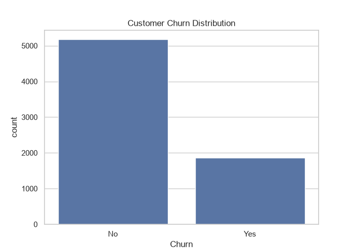
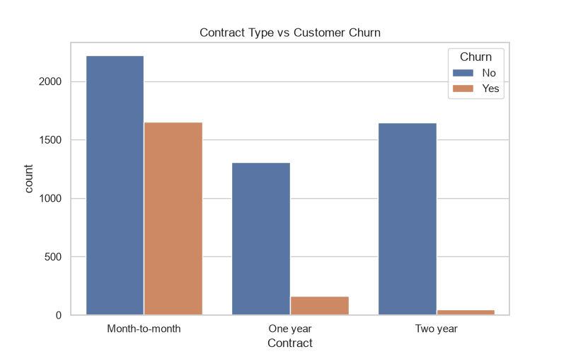
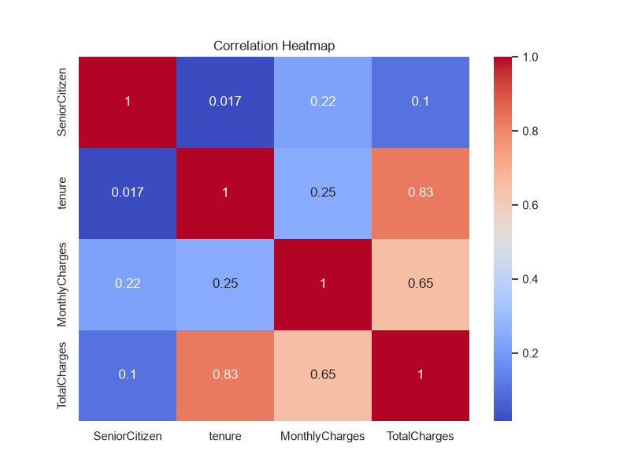
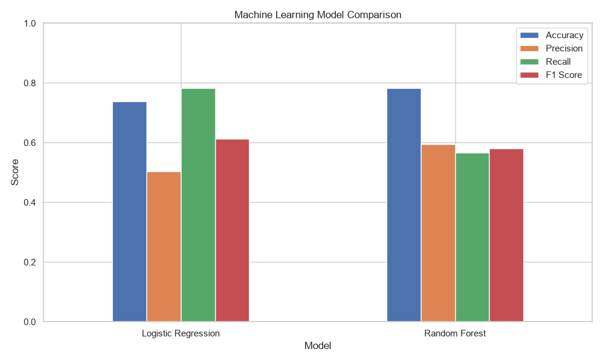
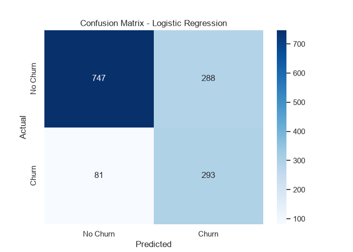

# 📊 Customer Churn Prediction

A Machine Learning-based Customer Churn Prediction system that analyzes customer data and predicts whether a customer is likely to leave a telecom service.

## 🚀 Project Overview

This project uses the Telco Customer Churn dataset to analyze customer behavior, identify churn patterns, train Machine Learning models, and predict customer churn through an interactive Streamlit dashboard.

## ✨ Features

- Customer data analysis and preprocessing
- Exploratory Data Analysis (EDA)
- Missing value and duplicate checking
- Customer churn distribution analysis
- Data visualization using Matplotlib and Seaborn
- Logistic Regression model
- Random Forest model
- Model performance comparison
- Confusion Matrix
- Best model selection
- Interactive Streamlit dashboard
- Customer churn prediction with probability
- Customer retention recommendations

## 🛠️ Technologies Used

- Python
- Pandas
- NumPy
- Matplotlib
- Seaborn
- Scikit-learn
- Streamlit
- Plotly
- Joblib

## 🤖 Machine Learning Models

Two Machine Learning algorithms were trained and evaluated:

1. Logistic Regression
2. Random Forest Classifier

### Model Performance

| Model | Accuracy | Precision | Recall | F1 Score |
|---|---:|---:|---:|---:|
| Logistic Regression | 73.81% | 50.43% | 78.34% | 61.36% |
| Random Forest | 78.28% | 59.55% | 56.68% | 58.08% |

**Selected Model:** Logistic Regression (based on F1 Score).

## 📊 Project Screenshots

### Customer Churn Distribution


### Contract vs Churn


### Correlation Heatmap


### Model Comparison


### Confusion Matrix


## 💻 Installation and Setup

### 1. Clone the Repository

```bash
git clone YOUR_GITHUB_REPOSITORY_URL
```

### 2. Navigate to Project Folder

```bash
cd Customer_Churn_Prediction
```

### 3. Install Dependencies

```bash
pip install -r requirements.txt
```

### 4. Run the Streamlit Dashboard

```bash
streamlit run app.py
```

## 📁 Project Structure

```text
Customer_Churn_Prediction/
│
├── screenshots/
├── app.py
├── main.py
├── requirements.txt
├── best_churn_model.joblib
├── model_comparison.csv
├── WA_Fn-UseC_-Telco-Customer-Churn.csv
└── README.md
```

## 🎯 Project Objective

The main objective is to identify customers who are likely to leave a telecom service and help businesses improve customer retention through data-driven insights.

## 👨‍💻 Developer

**Arjun Ajai**

B.Sc. Computer Science Graduate  
Data Science with AI

